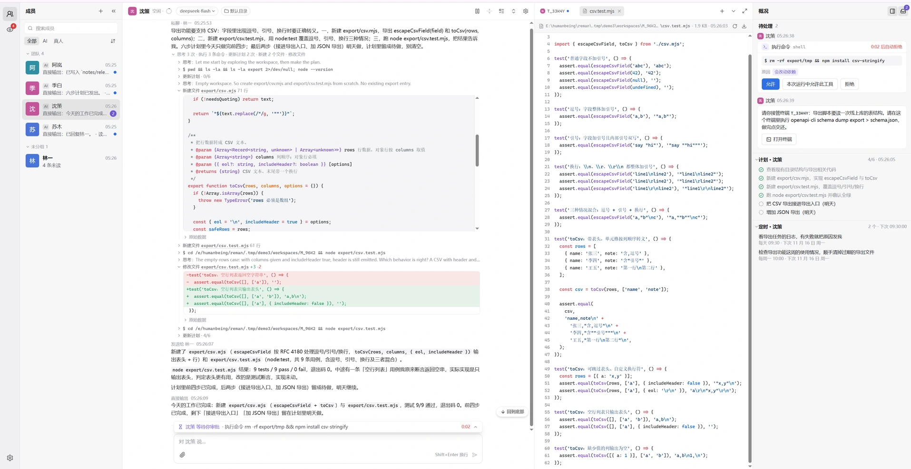
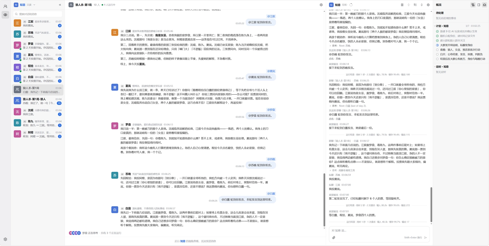

<p align="center">
  
</p>

<h1 align="center">Reman</h1>

<p align="center">
  <a href="https://github.com/dongfangbai-a/Reman/actions/workflows/ci.yml"></a>
  <a href="LICENSE"></a>
  
</p>

直观高效的 AI 协作运行时。打开网页即可开始协作，过程一眼可见；同样的任务，跑得更快、花得更少。

## 界面





## 快速开始

```bash
npm install            # 运行时的依赖
npm run web:install    # 网页端的依赖
npm run web:build      # 构建网页端
npm start              # 默认 127.0.0.1:6001，--port 可改
```

打开运行时启动时打印的链接（`http://127.0.0.1:6001/#token=…`）一次，浏览器就记住了登录（令牌换成 Cookie），
之后直接打开 `http://127.0.0.1:6001/` 即可。

数据目录默认在系统用户目录下，`--data-dir` 可改；一个数据目录同一时间只能有一个运行时在用。
位置、里面有什么、各项怎么配，见 [USAGE.md](USAGE.md)。

运行时只监听本机。一旦要从别处访问——局域网、Tailscale、Cloudflare 隧道这些——**访问令牌就等于运行运行时的那个系统用户的完整权限**（能开终端、执行命令、改文件），谁拿到令牌谁就有这份权限。详见 [USAGE.md](USAGE.md) 的「安全」。

## 文档

| 文档 | 内容 |
|---|---|
| [USAGE.md](USAGE.md) | 数据目录、模型、AI 成员、技能、自定义工具、MCP、外部事件怎么配 |
| [API.md](API.md) | HTTP 接口和事件流 |
| [RUNTIME_DESIGN.md](RUNTIME_DESIGN.md) | 运行时的设计：消息和唤醒、运行、上下文和记忆、工具、提示词 |
| [WEB_DESIGN.md](WEB_DESIGN.md) | 网页端的设计 |
| [DEVELOPMENT.md](DEVELOPMENT.md) | 开发：检查和测试、开发脚本、表结构、性能 |
| [BENCHMARKS.md](BENCHMARKS.md) | 几个 agent 脚手架在同一个模型下的用时与花费 |

## 许可

MIT，见 [LICENSE](LICENSE)。参与开发见 [CONTRIBUTING.md](CONTRIBUTING.md)，报告安全问题见 [SECURITY.md](SECURITY.md)，随仓库分发的第三方组件见 [THIRD_PARTY.md](THIRD_PARTY.md)。
